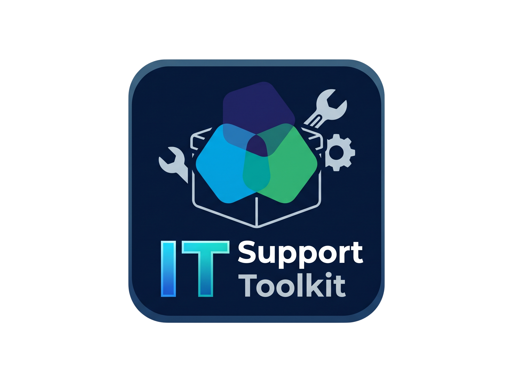

<p align="center">
  
</p>

<h1 align="center">IT Support Toolkit</h1>

<p align="center">
  Extension hỗ trợ kỹ thuật trên Chrome và Microsoft Edge, tối ưu cho quy trình vận hành Portal Long Vân.
</p>

<p align="center">
  <a href="https://github.com/thienhanaylai/Support-IT-Toolkit/releases/tag/v0.2.2.6"></a>
  
  
  
</p>

---

## Giới thiệu

**IT Support Toolkit** tập hợp các thao tác hỗ trợ kỹ thuật thường dùng vào một extension duy nhất:

- Kiểm tra IP Public, HTTP Ping và DNS over HTTPS.
- Quản lý mã TOTP Authenticator và tạo mật khẩu an toàn.
- Sao chép, đối chiếu và điền cấu hình VM trên Portal Long Vân.
- Theo dõi Ticket và Computing triển khai lỗi bằng lịch tự tải lại, thông báo Windows và badge chưa đọc.
- Soạn nội dung bàn giao VM bằng template và liên kết người dùng Matrix.
- Lưu lịch sử cục bộ và xuất báo cáo khi người dùng yêu cầu.

Extension chạy hoàn toàn trong trình duyệt, không cần Native Agent, backend, tài khoản riêng hoặc quyền Administrator. Dự án không thu thập telemetry.

## Tải nhanh

Tải bản mới nhất tại:

**[GitHub Releases — IT Support Toolkit v0.2.2.6](https://github.com/thienhanaylai/Support-IT-Toolkit/releases/tag/v0.2.2.6)**

| Gói | Mục đích |
|---|---|
| `ITSupportToolkit-Windows.exe` | Cài/cập nhật bằng một file trên Windows (bản 0.2.2.6). |
| `ITSupportToolkit-Windows.zip` | Bộ cài có mã script đọc được (bản 0.2.2.6). |
| `ITSupportToolkit-Edge-Store.zip` | Gói riêng để nộp/cập nhật Microsoft Edge Add-ons (bản 0.2.2.6). |

> [!NOTE]
> Bản **0.2.2.6** phát hành đồng thời bộ cài Windows và gói Edge Add-ons. Gói Edge Add-ons đã sẵn sàng để nộp lên Partner Center.

> [!NOTE]
> EXE chỉ chép extension production vào `%LOCALAPPDATA%\ITSupportToolkit\extension`. Nó không gọi PowerShell/CMD, không chạy script tạm, không dùng UI Automation và không tải mã thực thi từ Internet.

> [!WARNING]
> EXE hiện chưa được ký Authenticode nên Windows SmartScreen hoặc một số engine heuristic có thể hiển thị cảnh báo.

## Tính năng chính

### Công cụ mạng

| Công cụ | Cách hoạt động | Ghi chú |
|---|---|---|
| **IP Public** | Fetch `https://ifconfig.me/ip` | Kiểm tra và xác thực IPv4/IPv6, không gửi cookie. |
| **HTTP Ping** | HEAD/GET trực tiếp từ trình duyệt | Thực hiện 1–5 lần và đo tới response headers; không phải ICMP RTT. |
| **DNS over HTTPS** | Cloudflare, Google hoặc Quad9 | Hỗ trợ A, AAAA, CNAME, MX, TXT, NS, SOA, PTR, CAA và SRV. |
| **Thông tin VM** | Đọc DOM tab Portal hiện tại | Chỉ chạy khi người dùng chủ động nhấn nút. |

Các công cụ native cũ như ICMP Ping, Traceroute, TCP Port, quét Port, DNS hệ điều hành, SSL/TLS và mạng LAN không còn nằm trong UI/runtime Browser-only.

### Hỗ trợ Portal Long Vân

Quyền truy cập `https://portal.longvan.vn/*` là quyền tùy chọn, chỉ được yêu cầu sau khi người dùng chủ động cấp.

| Khu vực | Chức năng |
|---|---|
| **Trang Dịch vụ** | Sao chép CORE, RAM, Internet, Storage, OS, Site Provider, loại dịch vụ, chủ sở hữu và mã dịch vụ. |
| **Tạo Computing** | Dán tài nguyên, đối chiếu OS/Site, gợi ý tên VM, hỗ trợ tạo mật khẩu và tự chuyển **Hình thức Clone** từ LINKED sang FULL sau cùng. |
| **Tạo Computing nâng cao** | Điền Tên → Template → Cấu hình triển khai → CPU → RAM → Internet → Reservation → Disk, sau đó chuyển **Hình thức Clone** sang **Full** ở bước cuối. |
| **Chi tiết Computing** | Sao chép Link VM, Tên computing, Nhóm ảo hóa, Nhóm, Tên VM, VMID, VMP, Host và Resource Pool. |
| **Xác thực hai lớp** | Nhận diện hộp OTP và điền mã TOTP hiện tại mà không đưa secret vào content script. |

Extension không tự nhấn **Lưu** hoặc **Tạo VM**. Người dùng luôn kiểm tra và xác nhận dữ liệu trước khi gửi form.

### Copy VM, template và Matrix Tag

- Chỉnh sửa thông tin VM và thêm nội dung trước khi sao chép.
- Chọn template để chèn ngay; hỗ trợ tạo, cập nhật và xóa template.
- Template đã lưu hiển thị gọn theo từng dòng với nút chỉnh sửa và thùng rác.
- Quản lý Tag Element theo từng lĩnh vực hoặc từng thành viên.
- Tag được xuất dưới dạng liên kết Matrix chuẩn:

```text
[username](https://matrix.to/#/@iduser:domain)
```

- Giao diện dùng bảng màu xanh/vàng của Portal, hỗ trợ theme Sáng và Tối.

### Authenticator và Password Generator

- TOTP Authenticator: import liên kết, ảnh hoặc TXT; chọn vùng QR; tìm kiếm, sắp xếp, chỉnh sửa nhãn và export TXT.
- Secret TOTP được mã hóa AES-GCM trước khi lưu trong `chrome.storage.local`.
- Password Generator sử dụng `crypto.getRandomValues()`, hỗ trợ độ dài 4–128, nhóm ký tự, số ký tự đặc biệt và danh sách loại trừ.
- Mật khẩu gần đây chỉ tồn tại trong `chrome.storage.session`, không ghi vào lịch sử hoặc báo cáo.

## Cài đặt

### Cách 1: Dùng gói Windows

1. Tải `ITSupportToolkit-Windows.exe` từ trang Release.
2. Chạy file để chép extension vào:

   ```text
   %LOCALAPPDATA%\ITSupportToolkit\extension
   ```

3. Mở `chrome://extensions/` hoặc `edge://extensions/`.
4. Bật **Developer mode**.
5. Chọn **Load unpacked** và trỏ tới thư mục extension ở bước 2.

Bạn cũng có thể giải nén `ITSupportToolkit-Windows.zip` và chạy `Install.cmd`.

### Cách 2: Build từ mã nguồn

Yêu cầu Node.js 20+ và npm:

```powershell
git clone https://github.com/thienhanaylai/Support-IT-Toolkit.git
cd Support-IT-Toolkit\extension
npm ci
npm run build
```

Sau đó bật **Developer mode**, chọn **Load unpacked** và trỏ tới `extension/dist`.

### Cập nhật bản Load unpacked

- Nếu load từ `extension/dist`: chạy lại `npm run build`, rồi bấm **Reload/Tải lại**.
- Nếu load từ `%LOCALAPPDATA%\ITSupportToolkit\extension`: chạy bộ cài mới, rồi bấm **Reload/Tải lại**.
- Refresh các tab Portal đang mở để nạp content script mới.
- Giữ nguyên đường dẫn và Extension ID để bảo toàn dữ liệu trong `chrome.storage.local`.

## Quyền riêng tư và bảo mật

- Manifest không yêu cầu `nativeMessaging`.
- Không có backend riêng, tài khoản extension hoặc telemetry.
- IP Public gửi request tới `ifconfig.me`.
- HTTP Ping xin quyền theo đúng origin HTTP/HTTPS do người dùng nhập.
- DNS over HTTPS gửi truy vấn tới resolver công cộng đã chọn.
- Lịch sử chỉ lưu cục bộ tối đa 50 kết quả khi tùy chọn lưu được bật.
- Báo cáo HTML chỉ được tạo khi người dùng chủ động xuất.
- Các trường phổ biến như API key, authorization, password và token được loại khỏi dữ liệu lưu/xuất.

> [!IMPORTANT]
> Không dùng DNS resolver công cộng cho tên miền hoặc IP nội bộ nhạy cảm nếu chính sách của tổ chức không cho phép gửi truy vấn ra ngoài.

## Phát triển và kiểm thử

```powershell
cd extension
npm ci
npm test
npm run build
cd ..
.\packaging\test-setup.ps1
.\packaging\build-release.ps1 -Force
.\packaging\build-edge-store.ps1 -Force
```

Các script đóng gói xác minh phiên bản Manifest, file bắt buộc, cấu trúc ZIP và việc không có `nativeMessaging`.

## Tài liệu

- [Ghi chú phát hành](RELEASE_NOTES.md)
- [Hướng dẫn gói Windows](packaging/INSTALL.md)
- [Hướng dẫn Microsoft Edge Add-ons](packaging/EDGE_STORE.md)

---

<p align="center">
  <strong>IT Support Toolkit</strong> — công cụ hỗ trợ kỹ thuật nhanh, minh bạch và chạy trực tiếp trong trình duyệt.
</p>
